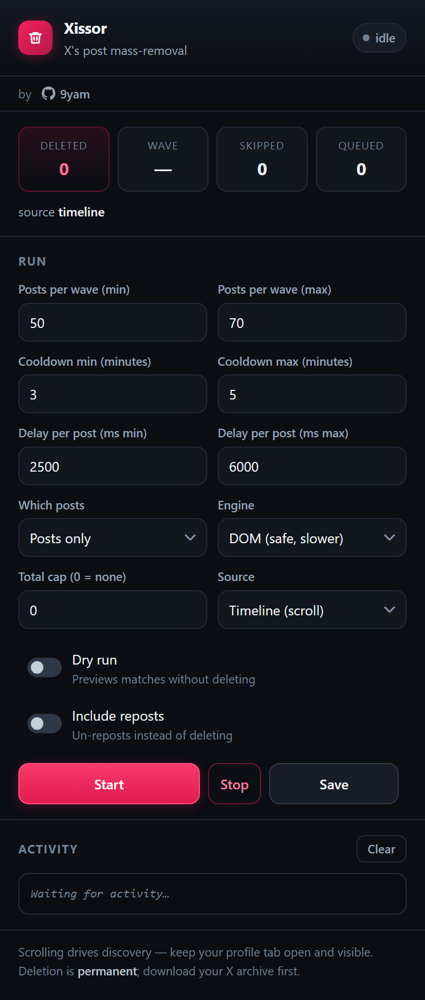
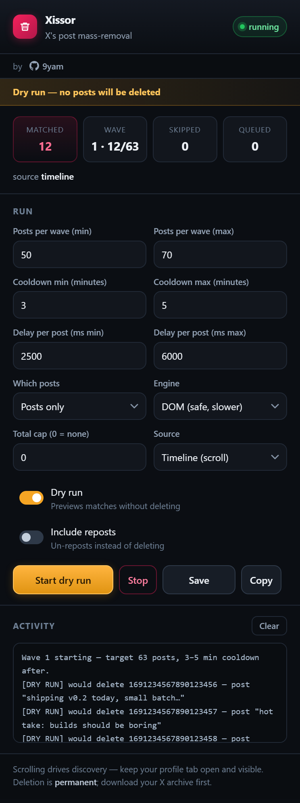
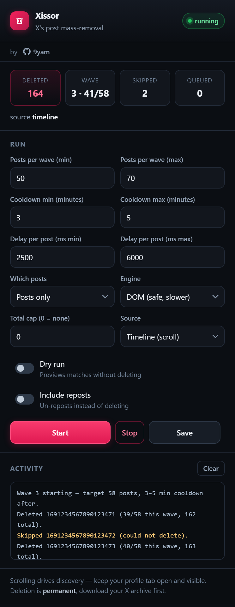
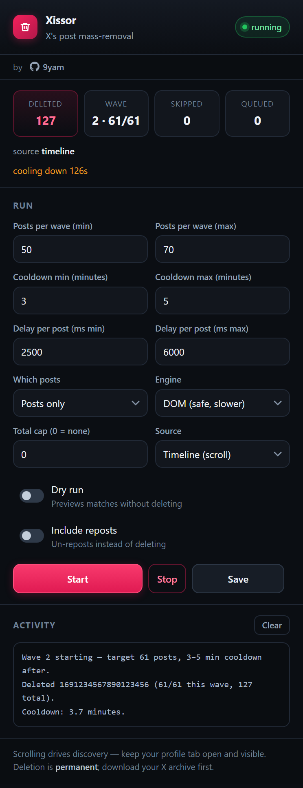
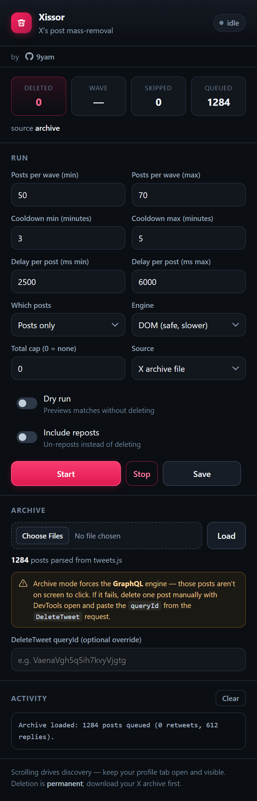
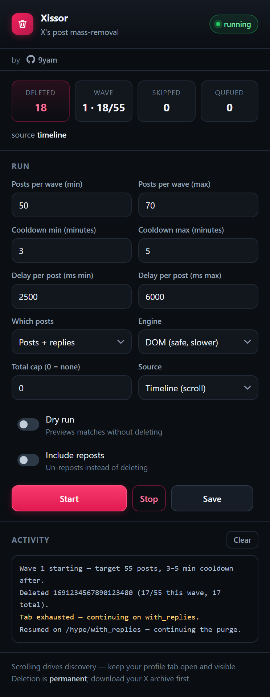

# Xissor

**X's post mass-removal.**

Xissor is a Chrome extension (Manifest V3) that deletes your own X/Twitter posts in
paced waves. It is deliberately built to look and behave nothing like a scraper: it
works from the rendered page, spaces deletions seconds apart, and pauses for several
minutes between waves.

It only ever acts on posts **you** authored. Others' posts, quoted posts, and other
people's reposts are never touched.

> **Deletion is permanent.** Download your X data archive before you start. Xissor
> cannot undo a delete, and X does not keep a user-facing copy.

---

## Contents

- [Screenshots](#screenshots)
- [Install](#install)
- [Quick start](#quick-start)
- [Features](#features)
- [The rate limiter](#the-rate-limiter)
- [Dry run](#dry-run)
- [Archive mode](#archive-mode)
- [Engines: DOM vs GraphQL](#engines-dom-vs-graphql)
- [Popup reference](#popup-reference)
- [Safety model](#safety-model)
- [Troubleshooting](#troubleshooting)
- [Tests](#tests)
- [Files](#files)

---

## Screenshots

**Idle** — the default view. Nothing is running until you press Start.



**Dry run** — finds and previews matches without deleting anything. The whole popup
shifts to amber and the primary button changes to *Start dry run*.



**Running** — live wave progress, per-post activity, and a running total.



**Cooldown** — a randomised 3–5 minute pause between waves, with a live countdown.



**Archive mode** — queue every post from your X data export, no scrolling needed.



**Replies** — walk your replies tab as well as your main profile.



---

## Install

Xissor is not on the Chrome Web Store; load it unpacked.

1. Download or clone this folder.
2. Open `chrome://extensions`.
3. Enable **Developer mode** (top right).
4. Click **Load unpacked** and select the project folder (the one containing
   `manifest.json`).
5. Pin the extension so the popup is one click away.

Works in Chrome and other Chromium browsers (Edge, Brave, Arc). Firefox needs
Manifest V3 changes and is not supported.

**Permissions:**

| Permission | Why |
| --- | --- |
| `storage` | Remember your settings and the activity log |
| `tabs` | Find the active tab and read its URL to confirm you are on your profile |
| `https://x.com/*`, `https://twitter.com/*` | Act on x.com pages only |

Xissor has no analytics, no telemetry and no network calls of its own. It requests no
access to your cookies through the `cookies` permission; the one cookie it reads
(`ct0`) is read directly from the page at runtime, held in memory for the session, and
never stored.

---

## Quick start

1. Open **your own profile** on x.com, e.g. `https://x.com/yourhandle`.
   Xissor reads your handle from the URL; it must be your profile, not the home feed.
2. Click the Xissor icon.
3. Tick **Dry run** and press **Start dry run** first. Read the log. A useful dry run
   finds posts and logs one line per match.
4. Untick dry run, press **Start**, and leave the tab alone.

The first wave targets a random 50–70 posts. When it finishes, Xissor cools down for
3–5 minutes and continues automatically. Press **Stop** at any time — it halts at the
next safe point.

---

## Features

### Deletes only your own posts

Authorship is proven from each card's permalink (`/handle/status/123…`), not from
layout or text. If your handle cannot be read from the URL, Xissor refuses to act
rather than guessing. Cards with no resolvable author are skipped and counted.

### Paced, randomised deletion

Three independent randomisations keep the pattern human and far below anything X
treats as abuse:

- **Wave size** — 50–70 posts per wave, re-rolled every wave.
- **Per-post gap** — 2.5–6 seconds between deletions.
- **Cooldown** — 3–5 minutes between waves.

Sustained throughput works out to roughly **7 posts per minute**, which clears a few
thousand posts over a few hours without a burst.

### Automatic 429 handling

If X answers with HTTP 429, Xissor immediately stops the wave and enters cooldown
early instead of retrying harder. Repeated 429s are a signal to slow down, not to
retry.

### Dry run

Every match is logged and listed without touching X. Nothing is deleted, no mutation
is ever sent, and the list can be copied out as JSON for review.

See [Dry run](#dry-run).

### Two deletion engines

- **DOM** (default) — clicks the post's ⋯ menu, then Delete, then confirms. Slower
  but resilient, because it uses what is on screen instead of a private API.
- **GraphQL** — calls X's `DeleteTweet` mutation directly. Much faster, but X rotates
  query IDs, so it can break without warning.

See [Engines](#engines-dom-vs-graphql).

### Replies support

"Which posts" can target:

- **Posts only** — originals on your profile.
- **Replies only** — everything on your `/with_replies` tab.
- **Posts + replies** — both, walking from one tab to the next automatically.

When your profile tab runs out of matching posts, Xissor moves to the replies tab and
resumes. Progress is stashed in `sessionStorage`, so the walk survives navigation.

### Archive mode

Point Xissor at your downloaded X archive (`tweets.js`) and it queues every post by id
— no scrolling, no missed posts. Handles multi-file archives, deduplicates across
shards, and processes oldest-first.

See [Archive mode](#archive-mode).

### Optional reposts

Off by default. When enabled, Xissor removes your reposts (un-reposts) instead of
deleting them. Reposts are the one place authorship comes from the byline rather than
the permalink, since a repost card shows the *original* author.

### Caps and confirmation

- **Max total** — stop after N deletions (0 means unlimited).
- **Confirm each wave** — require a click before each wave instead of continuing
  automatically.

### Live feedback

Four stat cards (deleted / wave / skipped / queued), a cooldown countdown, the active
engine and source, and a colour-coded activity log where warnings and errors stand
out. The log persists across popup closes.

---

## The rate limiter

Per wave, with the defaults:

| Setting | Default | Effect |
| --- | --- | --- |
| Wave size | 50–70 | Posts per wave, re-rolled each time |
| Gap between deletes | 2.5–6 s | Jittered per post |
| Cooldown | 3–5 min | Random pause after each wave |
| Max total | 0 (off) | Hard stop after N posts |

These are conservative on purpose. A full-speed script would delete a thousand posts
in minutes and is exactly the traffic pattern that gets an account flagged. Xissor
aims for the pace of someone deleting posts by hand for a while, then taking a break.

Deletion is also serial — one post at a time, waiting for each to resolve before
starting the next.

---

## Dry run

Dry run is the recommended first step and the answer to "why did nothing happen?".

In dry run Xissor:

- scrolls and collects cards exactly as a live run does,
- applies the same authorship and mode filters,
- logs `[DRY RUN] would delete <id> — <preview>` for each match,
- paces identically, so you see the real rhythm,
- **never** sends a deletion and never opens a menu.

If a dry run finds nothing, the problem is discovery or ownership — not deletion.
That is the separation dry run exists to give you.

**Copy** exports the match list as JSON so you can inspect ids offline.

---

## Archive mode

X's profile view is unreliable for very large accounts (virtualised lists, truncated
timelines). The archive route sidesteps it.

1. Request your archive from X: *Settings → Your account → Download an archive of your
   data*, then confirm by email. It can take a day.
2. Unzip it and find `data/tweets.js` (and `tweets-part1.js`, … if split).
3. In Xissor set **Source** to *X archive file*, choose the files, press **Load**.
4. Xissor reports how many posts, retweets and replies it parsed.

Behaviour notes:

- X strips the `window.YTD.tweets.part0 =` prefix before parsing; Xissor reattaches it.
- Multiple shards are merged, deduplicated by id, and sorted oldest-first.
- Archive mode forces the GraphQL engine, because there is no card on screen to click.
- A `404` on a delete is treated as success — the post is already gone.
- Each id gets at most 3 attempts; 8 consecutive failures stop the run rather than
  grinding through a broken session.
- Reposts in the archive are skipped: `DeleteTweet` cannot un-repost.

**Always keep the unzipped archive.** It is your only record of what was deleted.

---

## Engines: DOM vs GraphQL

| | DOM (default) | GraphQL |
| --- | --- | --- |
| Speed | Slower | Fast |
| Breaks when X changes its API | No | Yes, often |
| Breaks when X changes its layout | Sometimes | No |
| Needs the post on screen | Yes | No |
| Used by archive mode | No | Yes |

DOM is the default because it is the one that keeps working. GraphQL is worth enabling
for a large backlog, but expect to re-discover the query ID when X rotates it.

If the DOM engine cannot find a post menu, the log says so explicitly
("Could not find the post menu (layout changed?)") instead of failing silently.

---

## Popup reference

**Header** — state pill (`idle` / `running` / `cooling`), author credits.

**Stats**

| Card | Meaning |
| --- | --- |
| Deleted / Matched | Total removed — or, in dry run, total matched |
| Wave | Current wave number and progress within it |
| Skipped | Posts found but not deleted (wrong author, no menu, error) |
| Queued | Remaining posts in an archive queue |

**Run**

- **Which posts** — Posts only / Replies only / Posts + replies
- **Engine** — DOM or GraphQL
- **Source** — Timeline (scroll) or X archive file
- **Pace** — wave size, gap, cooldown, total cap
- **Also un-repost reposts** — off by default
- **Dry run** — preview only

**Archive** — file picker and Load, visible only when Source is *X archive file*.

**Activity** — colour-coded log; **Clear** (in the log header) empties it. **Copy**
exports the dry-run match list as JSON — it only appears during a dry run.

**Footer buttons** — Start / Stop / Save. *Save* persists your settings.

---

## Safety model

What Xissor does to avoid deleting the wrong thing or getting you rate-limited:

1. **Permalink-based authorship.** The author is parsed from
   `/<handle>/status/<id>`; display names and text are never trusted.
2. **Refuses ambiguous pages.** No handle in the URL means no action, not a guess.
3. **One post at a time.** No parallelism, no batching of mutations.
4. **Randomised pacing.** Wave size, gap and cooldown all vary.
5. **Backs off on 429** instead of retrying.
6. **Dry run by default for new users** — nothing mutates until you say so.
7. **No network calls of its own.** Xissor talks to x.com only through the page you
   are already on.
8. **Hard caps.** Max total, per-id attempt limit, and a consecutive-failure stop.

What Xissor cannot protect you from: deleting posts you wanted to keep. Keep the
archive.

---

## Troubleshooting

**Dry run reports nothing found.**

- Confirm you are on `x.com/<yourhandle>`, not the home feed or a search page.
- Your handle must be readable from the URL — that is how ownership is decided.
- Scroll the profile first so cards exist in the DOM.
- If you have thousands of posts, try [archive mode](#archive-mode) instead.

**"Could not find the post menu (layout changed?)"**

X changed its markup. The DOM engine's selectors (`caret`,
`confirmationSheetConfirm`) need updating in `src/content.js`. Re-run a dry run to see
whether cards are still found — discovery can work even when deletion fails.

**GraphQL returns errors or 404s on every post.**

X rotated its query ID. Switch to the DOM engine, which does not depend on it.

**Deletions stop after a while.**

Likely a cooldown, a `maxTotal` cap, or 429 back-off. Check the log and the countdown
under the stat cards.

**The popup shows stale numbers.**

Close and reopen it; status comes from the content script on open.

---

## Tests

The logic most likely to cause damage is unit tested without a browser. Run any file
directly:

```bash
node test/selection.test.js      # authorship + dedup filter
node test/dryrun.test.js         # proves dry run cannot reach a mutation
node test/archive.test.js        # tweets.js parser: prefix, dedup, sorting
node test/archive-runner.test.js # status mapping, retry cap, retweet filtering
node test/replies.test.js        # reply author detection + tab routing
```

Or all at once:

```bash
for t in test/*.test.js; do node "$t" || exit 1; done
```

---

## Files

```
manifest.json
README.md                this document
docs/img/*.png           generated screenshots
src/
  content.js             engine: discovery, DOM deletes, GraphQL deletes, rate limiter
  background.js          service worker: status + log relay, badge
  popup.html/.js         controls and live status
  archive.js             archive parser (UI-free, unit tested)
  config.js              shared constants
test/                    unit tests (no browser needed)
```

---

## Credits

By [9yam](https://github.com/9yam)

Not affiliated with X Corp. Use at your own risk.
